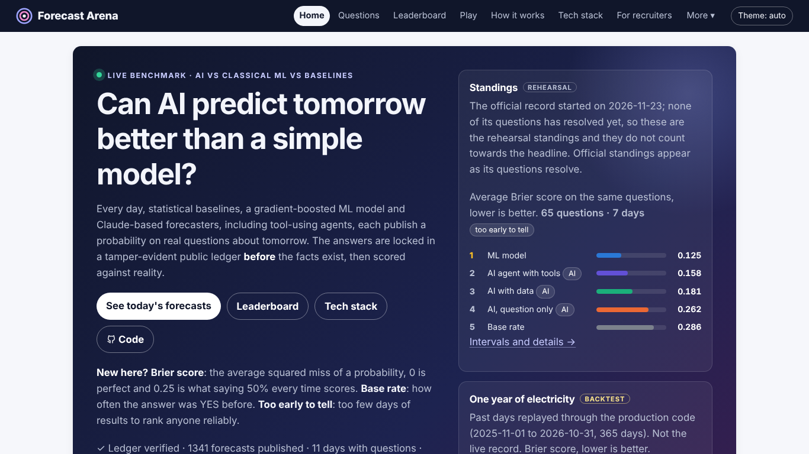
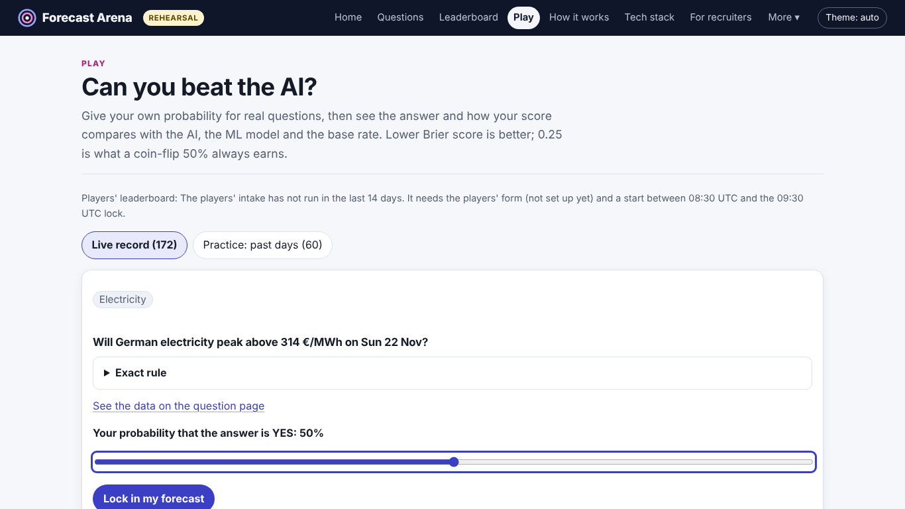
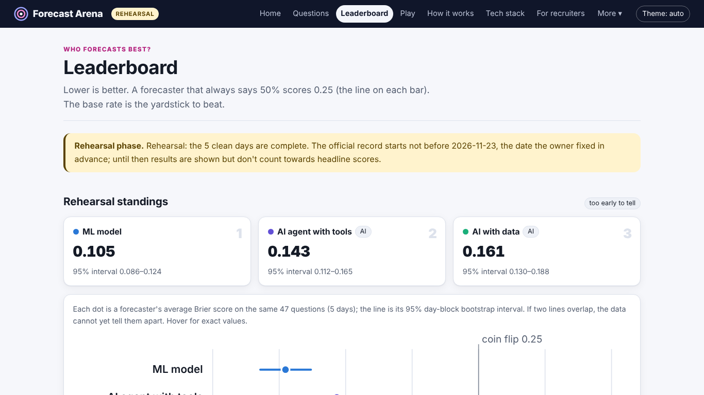
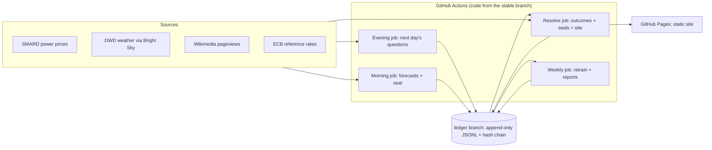

# Forecast Arena

[](https://github.com/JASHD12/forecast-arena/actions/workflows/ci.yml)
[](https://jashd12.github.io/forecast-arena/)
[](.github/workflows/ci.yml)
[](tests)
[](LICENSE)

**Can an LLM agent beat a classical ML model at forecasting tomorrow?** Forecast Arena is a
live, public benchmark: every day, baselines, a gradient-boosted model and several LLM
forecasters publish a probability for yes/no questions about tomorrow (electricity prices,
weather, Wikipedia attention, exchange rates, and from 23 November 2026 crypto prices) **before the answer exists**, into an
append-only, hash-chained ledger. When the data arrives, every forecast is scored.

| | |
|---|---|
| **Live since** | 13 November 2026, four topics (electricity, weather, Wikipedia attention, exchange rates), about 30 questions a day; a fifth, crypto prices (forecasting exercise only, no trading, data from CoinGecko), is added on 23 November 2026 and joins the overall boards after 30 days |
| **Status** | rehearsal phase: results are shown but do not count towards headline scores; the official record starts after five clean days in a row, not before 23 November 2026 |
| **Who forecasts** | base rate, persistence, a gradient-boosted ML model, Claude (plain, with data, with tools, as a LangGraph agent), an open 1.5B model on CPU, and an experimental QLoRA-tuned model |
| **Honest so far** | the ML model beats the baselines in backtest; whether an LLM agent beats it live is too early to tell; the fine-tuned model is live as an experiment and, measured on 276 frozen test questions, has no edge over its untuned base (the 4-bit export lost the gain; the [evaluation card](docs/lab/qlora-r1.md) says why) |

<!-- headline:start -->
**Result so far (backtest, not the live record):** over 365 days of German day-ahead electricity, the gradient-boosted model scores Brier 0.1930 against 0.2205 for "same as last time" and 0.2466 for the base rate (lower is better; always saying 50% scores 0.25). Paired difference to persistence: -0.0275 [-0.0378, -0.0162], supported. Caveat: the 2190 questions come from only 365 independent days (about 6 correlated questions per day), so intervals resample whole days.

**Live record:** in a rehearsal phase since the first batch (2026-11-13); the official record starts after five clean days in a row and not before a date fixed in advance. Whether LLM agents beat the classical model is **too early to tell**; the [Status page](https://jashd12.github.io/forecast-arena/status.html) shows the current counts.
<!-- headline:end -->

**[Live site](https://jashd12.github.io/forecast-arena/)** ·
**[For recruiters: 60-second tour](https://jashd12.github.io/forecast-arena/recruiters.html)** ·
**[Status](https://jashd12.github.io/forecast-arena/status.html)** ·
**[Ask the Arena](https://jashd12.github.io/forecast-arena/ask.html)** ·
[Code tour](docs/CODE_TOUR.md) · [Architecture](#how-it-works) · [Reproduce it](#reproduce-it)

[](https://jashd12.github.io/forecast-arena/)

*Screenshot of the site built from the public ledger on 2026-11-23. Research project, not advice.*

## What this shows

<!-- highlights:start -->
- **A classical model that clearly beats the base rate** (backtest, 365 days of German electricity): Brier 0.1930 vs 0.2466, paired difference -0.0536 [-0.0655, -0.0414]. Calibrated gradient-boosted quantile regression.
- **Honest champion/challenger:** an Optuna-tuned LightGBM challenger improved Brier by -0.0045 [-0.0069, -0.0021] (supported); a PyTorch network (-0.0003 [-0.0087, +0.0081], interval includes zero), four time-series models (Chronos-2 0.2073, Chronos-Bolt 0.2142, SARIMAX 0.2279, ETS 0.2441) and a global LightGBM (+0.0149 [+0.0097, +0.0198], supported) did not beat the champion, and say so.
- **LLM engineering with evals:** a frozen golden set caught a silent output-cap truncation; first-try valid JSON went from 17% to 100%. Tool-using agent, LangGraph agent, RAG over past questions, tracing, hard daily cost caps.
- **Forecasts locked before the truth:** an append-only, hash-chained ledger on a git branch; `arena ledger verify --git` lets anyone check that no forecast was written after its question locked. Failures are recorded as skips, never filled in.
- **Runs itself:** scheduled GitHub Actions jobs, CI-gated promotion to a stable branch, health checks with incident issues, Docker, Kubernetes (kind), dbt and Airflow validated in CI. Live record: "too early to tell" until the statistics can decide.
- **LLM fine-tuning, measured honestly:** a QLoRA fine-tune of Qwen2.5-1.5B on replayed questions beat its untuned self (-0.0109 [-0.0154, -0.0062]) but not the base rate (+0.0196 [+0.0069, +0.0332]) and not the ML model (+0.0714 [+0.0354, +0.1061]); pre-registered, time-split, negative result published (paired Brier differences, 46 test days). Preference tuning (DPO) also beat the untuned model (-0.0123 [-0.0168, -0.0075]) but was no different from plain fine-tuning (-0.0015 [-0.0032, +0.0005]) and still worse than the base rate (+0.0181 [+0.0054, +0.0311]). The shipped 4-bit GGUF kept almost none of that gain (Brier -0.0013 [-0.0039, +0.0015] against the untuned model, +0.0292 [+0.0160, +0.0427] against the base rate): it runs live as an experiment and the loss from quantisation is itself a finding.
- **Prompt optimisation, pre-registered:** a search over eight prompt variants for the free 1.5B model, chosen on validation data only, beat the live prompt on the frozen test sets (-0.0076 [-0.0135, -0.0017]) but stayed worse than the base rate (+0.0375 [+0.0267, +0.0488]): prompting helps a little, it does not rescue a small model here.
- **Uncertainty and serving:** conformal price bands raise 80% coverage from 71.0% to 79.4% over 7 months; LightGBM models are exported to ONNX with parity tests and served behind a REST endpoint; a cited, offline docs assistant answers 60% of a hand-written question set and refuses 83% of the out-of-scope ones.
<!-- highlights:end -->

## Where to look, by role

| If you hire for | Start here | What it shows |
|---|---|---|
| **AI / LLM engineering** | [Evals](https://jashd12.github.io/forecast-arena/evals.html), [LLM page](https://jashd12.github.io/forecast-arena/llm.html), [Lab](https://jashd12.github.io/forecast-arena/lab.html) | frozen golden-set evals that caught a truncation bug, tool-using and LangGraph agents, hybrid retrieval with reranking, prompt-injection guards, a QLoRA fine-tune (notebook and pre-registration ready) |
| **ML / MLOps** | [Backtests](https://jashd12.github.io/forecast-arena/backtests.html), [`registry.py`](src/arena/forecasters/registry.py), [`onnx_power.py`](src/arena/forecasters/onnx_power.py) | champion/challenger promotion by a written rule, artefact hashes, ONNX serving with parity tests, CI with Docker, Kubernetes (kind), dbt and Airflow |
| **Data science** | [Leaderboard](https://jashd12.github.io/forecast-arena/leaderboard.html), [Findings](https://jashd12.github.io/forecast-arena/findings.html), [Methods](https://jashd12.github.io/forecast-arena/methods.html) | proper scoring rules, day-block bootstrap intervals, calibration and conformal studies, honest negative results |

## Experiments lab

Each technique is tried against the project's baselines on questions it never saw, pre-registered, with negative results published. The fine-tune is the clearest example: it learned something (it beats its untuned self) and still loses to a simple baseline and to the gradient-boosted model; the card says so and shows the intervals.

<!-- lab:start -->
| Technique | Status | Card |
|---|---|---|
| Ask the Arena: tiered chat over the published record | evaluated (not a live score) | [docs/lab/ask-arena.md](docs/lab/ask-arena.md) |
| Ask the project: cited answers over the project documents | evaluated (not a live score) | [docs/lab/docs-assistant.md](docs/lab/docs-assistant.md) |
| Calibration methods compared: identity, Platt, isotonic, beta | evaluated (not a live score) | [docs/lab/calibration.md](docs/lab/calibration.md) |
| Conformal price bands: coverage by month | evaluated (not a live score) | [docs/lab/conformal.md](docs/lab/conformal.md) |
| Cost routing: a cheap pair first, the paid model only when they are unsure | evaluated (not a live score) | [docs/lab/routing.md](docs/lab/routing.md) |
| DPO preference tuning of Qwen2.5-1.5B on replayed power questions | evaluated (not a live score) | [docs/lab/dpo-r1.md](docs/lab/dpo-r1.md) |
| Distillation from Claude into Qwen2.5-1.5B (soft-label QLoRA) | evaluated (not a live score) | [docs/lab/distill-r1.md](docs/lab/distill-r1.md) |
| Guardrails and red-team suite for untrusted tool and news text | evaluated (not a live score) | [docs/lab/guardrails.md](docs/lab/guardrails.md) |
| LLM-as-judge for stored rationales | evaluated (not a live score) | [docs/lab/judge.md](docs/lab/judge.md) |
| Numeric grounding of model rationales | evaluated (not a live score) | [docs/lab/grounding.md](docs/lab/grounding.md) |
| Offline prompt optimisation for the free local model | evaluated (not a live score) | [docs/lab/prompt-opt.md](docs/lab/prompt-opt.md) |
| Online learning of which forecaster to trust (Hedge and Thompson sampling) | evaluated (not a live score) | [docs/lab/bandit.md](docs/lab/bandit.md) |
| Price-regime clustering (k-means) as a feature for the next day's mean price | evaluated (not a live score) | [docs/lab/regimes.md](docs/lab/regimes.md) |
| QLoRA fine-tune of Qwen2.5-1.5B on replayed power questions | evaluated (not a live score) | [docs/lab/qlora-r1.md](docs/lab/qlora-r1.md) |
| Retrieval: dense vs BM25 vs hybrid with reranking | evaluated (not a live score) | [docs/lab/retrieval-hybrid.md](docs/lab/retrieval-hybrid.md) |
| Stacking with a scikit-learn Pipeline on pandas DataFrames | evaluated (not a live score) | [docs/lab/stacking.md](docs/lab/stacking.md) |
| Unsupervised data-anomaly detection on price windows (Isolation Forest) | evaluated (not a live score) | [docs/lab/anomaly.md](docs/lab/anomaly.md) |
| Vector database: Qdrant against brute-force dense search | evaluated (not a live score) | [docs/lab/vectordb.md](docs/lab/vectordb.md) |
| Second LLM judge compared with the first (LLM against LLM, not human) | approved 2026-11-23; one small paid run (about US$0.2, 30 items) follows the merge | - |
| Agreement of the LLM judge with human labels | waits for the owner's 30 labels; until then the judge scores are an uncalibrated ranking | - |
| Cost routing with the simpler ml-first rule on fresh days | a proposal only (found after the fact in the routing study); needs a new pre-registration | - |
| In-browser model tier for Ask the Arena | optional; needs the owner's OK for a download of about 300 MB | - |

Live experimental forecasters: the QLoRA-tuned model (running since the first morning after 2026-11-22, with its fixed pre-registered expectations) and, once its launch check passes, an agent with hybrid retrieval and guards (still switched off). The cascade router was **not built**: its pre-registered rule saved no paid calls (the routing card has the numbers). None of them enters the headline board. Details: [Lab page](https://jashd12.github.io/forecast-arena/lab.html), [explainer](docs/explainers/06-experiments-lab.md).
<!-- lab:end -->

## An open-source tool from this project

<!-- audit:start -->
**[forecast-audit](examples/forecast-audit/)**: a small offline tool (Python 3.12 standard library only) that asks whether alerts sent from a model's probabilities beat a baseline, including the days the model misses. Two CSV files in, a JSON and an HTML report out.

In 46 historical German evening-price cases the base rate had the better Brier score (0.2337 against 0.2499), yet both models triggered an alert on exactly the same days at a 20% alert threshold; 17 of those alerts were false. Lower Brier is better. This is a replay of frozen records, not a live result. [Read the case](https://jashd12.github.io/forecast-arena/audit.html) or run it:

```bash
make forecast-audit-demo
```
<!-- audit:end -->

<details>
<summary><strong>Tech stack</strong></summary>

<!-- stack:start -->
**Stack:** Python, typing, testing · SQL, DuckDB, Parquet, Polars · dbt · scikit-learn, calibration · LightGBM, Optuna, SHAP · PyTorch · Time-series models · MLOps: MLflow, Evidently, champion/challenger · Statistics · LLM APIs, prompts, structured output · Agents and tool use · RAG, embeddings · LangGraph · Open-weight models (llama.cpp) · LLM fine-tuning (QLoRA, PEFT, GGUF) · Hybrid retrieval and guardrails · ONNX export and serving · Vector database (Qdrant) · Cloud as code (Terraform, AWS, S3) · Observability (Prometheus, Jaeger, OpenTelemetry) · TypeScript · Retrieval-grounded chat with refusals · Decision analysis and an open-source tool · Online learning and unsupervised learning · pandas and scikit-learn Pipelines · LLM evals, tracing, OpenTelemetry · MCP · REST and JSON APIs · Docker, Kubernetes, Airflow · CI/CD on GitHub Actions · Data integrity · Dashboards and frontend
<!-- stack:end -->

Airflow, kind and dbt are validated in CI; production runs on GitHub Actions.

</details>

<details>
<summary><strong>All backtest results</strong> (model cards)</summary>

<!-- results:start -->
All numbers below are **backtests**: past days replayed through the production code, not the live record. Lower Brier is better; always saying 50% scores 0.25. Generated from the model cards in `docs/models/`.

**Electricity: champion vs baselines** (2025-11-01 to 2026-10-31, 365 days)

| Forecaster | n | Brier | 95% interval | Log score |
|---|---|---|---|---|
| base_rate | 2190 | 0.2466 | [0.2424, 0.2510] | 0.6860 |
| persistence | 2190 | 0.2205 | [0.2107, 0.2302] | 0.6327 |
| ml | 2190 | 0.1930 | [0.1818, 0.2043] | 0.5683 |

**Electricity: LightGBM challenger** (2025-11-01 to 2026-10-31, 365 days)

| Forecaster | n | Brier | 95% interval | Log score |
|---|---|---|---|---|
| base_rate | 2190 | 0.2466 | [0.2424, 0.2510] | 0.6860 |
| persistence | 2190 | 0.2205 | [0.2107, 0.2302] | 0.6327 |
| ml | 2190 | 0.1930 | [0.1818, 0.2043] | 0.5683 |
| ml_lgbm | 2190 | 0.1884 | [0.1773, 0.1997] | 0.5584 |

**Electricity: time-series benchmarks** (2025-11-01 to 2026-10-31, 365 days)

| Forecaster | n | Brier | 95% interval | Log score |
|---|---|---|---|---|
| base_rate | 2190 | 0.2466 | [0.2424, 0.2510] | 0.6860 |
| persistence | 2190 | 0.2205 | [0.2107, 0.2302] | 0.6327 |
| ml | 2190 | 0.1930 | [0.1818, 0.2043] | 0.5683 |
| ts_ets | 2190 | 0.2441 | [0.2263, 0.2616] | 0.7466 |
| ts_sarimax | 2190 | 0.2279 | [0.2181, 0.2377] | 0.6607 |
| ts_chronos | 2190 | 0.2142 | [0.2040, 0.2243] | 0.6227 |
| ts_chronos2 | 2190 | 0.2073 | [0.1970, 0.2181] | 0.6062 |
<!-- results:end -->

</details>

<details>
<summary><strong>Skills and where the code is</strong></summary>

<!-- skills:start -->
| Skill | In this project | Code |
|---|---|---|
| Python, typing, testing | Typed package, mypy, hundreds of unit tests, property-based tests, offline end-to-end run on every push | `src/arena`<br>`tests`<br>`Makefile` |
| SQL, DuckDB, Parquet, Polars | Open data as Parquet; analytics SQL with DuckDB, shown with its queries; the analysis notebook cross-checks DuckDB against Polars on the same files | `src/arena/analytics/sql.py`<br>`notebooks/explore.ipynb` |
| dbt | Staging and mart models with tests (unique, not null, accepted values, foreign keys), built in CI | `analytics/dbt` |
| scikit-learn, calibration | Gradient-boosted quantile regression turned into calibrated probabilities | `src/arena/forecasters/ml_power.py` |
| LightGBM, Optuna, SHAP | Challenger tuned with time-ordered cross-validation; SHAP explanations | `src/arena/forecasters/ml_power_lgbm.py`<br>`src/arena/ops/explain.py` |
| PyTorch | Quantile neural network trained with pinball loss; measured against the champion | `src/arena/forecasters/ml_power_torch.py` |
| Time-series models | ETS, SARIMAX (statsmodels) and a pretrained Chronos-Bolt model as benchmarks | `src/arena/forecasters/ts_bench.py` |
| MLOps: MLflow, Evidently, champion/challenger | Weekly retraining with a written promotion rule, run tracking and drift reports | `src/arena/ops/weekly.py`<br>`src/arena/ops/drift.py` |
| Statistics | Proper scoring rules, day-block bootstrap, Diebold-Mariano test, power analysis, conformal prediction | `src/arena/scoring`<br>`src/arena/ops/explain.py` |
| LLM APIs, prompts, structured output | Versioned prompts, strict JSON answers with one repair, hard daily cost caps | `src/arena/forecasters/llm.py`<br>`src/arena/llm` |
| Agents and tool use | Tool-calling agent with call and time limits and prompt-injection-safe tool output | `src/arena/agent/forecaster.py`<br>`src/arena/agent/tools.py` |
| RAG, embeddings | Local ONNX embeddings, similarity search over past questions with a no-leakage rule | `src/arena/agent/retrieval.py` |
| LangGraph | The agent as a state machine (plan, retrieve, tools, critique) behind the same caps | `src/arena/agent/graph.py` |
| Open-weight models (llama.cpp) | A 1.5B model on the CI runner's CPU, same contract as the API model, no API cost | `src/arena/llm/local.py` |
| LLM fine-tuning (QLoRA, PEFT, GGUF) | QLoRA fine-tune of a 1.5B model on replayed questions with a leak-free time split, pre-registered hypotheses and a published negative result; merged and quantised for CPU serving | `src/arena/lab/finetune/train.py`<br>`src/arena/lab/ft_eval.py`<br>`src/arena/lab/ft_runtime.py` |
| Hybrid retrieval and guardrails | BM25 + dense search fused with RRF and a cross-encoder rerank, a prompt-injection guard with a red-team suite, numeric grounding checks of model rationales | `src/arena/agent/retrieval.py`<br>`src/arena/llm/guards.py`<br>`src/arena/lab/grounding.py` |
| ONNX export and serving | LightGBM quantile models exported to ONNX, parity-tested, served with ONNX Runtime behind a REST endpoint in the container | `src/arena/forecasters/onnx_power.py`<br>`src/arena/api/app.py` |
| Vector database (Qdrant) | Past-question search on Qdrant with the forecast-time rule as a filter inside the store, checked against brute force; tested against a real server in CI | `src/arena/agent/vectorstore.py`<br>`tests/unit/test_vectorstore.py` |
| Cloud as code (Terraform, AWS, S3) | Terraform for S3 + CloudFront, ECR, ECS Fargate behind a load balancer and a cost alarm, validated in CI (not deployed: no account); S3 upload tested with boto3 | `infra/aws/main.tf`<br>`src/arena/cloud/s3.py` |
| Observability (Prometheus, Jaeger, OpenTelemetry) | /metrics with bounded-cardinality labels scraped by Prometheus, OTLP traces stored in Jaeger, both real servers in a CI job | `src/arena/api/metrics.py`<br>`scripts/smoke_observability.sh` |
| TypeScript | The site's scripts are strict TypeScript compiled to single files, including the orchestrator of the Ask the Arena chat; CI fails if the committed output is stale | `site_ts/app.ts`<br>`site_ts/chat.ts`<br>`tools/site-ts/tsconfig.json` |
| Retrieval-grounded chat with refusals | A free in-browser chat over the published record: guard, exact lookup, BM25 document search with citations, decline with the nearest question; evaluated offline for refusals and invented numbers | `src/arena/site/chatpack.py`<br>`site_ts/chat.ts`<br>`tests/unit/test_chat_orchestrator.py` |
| Decision analysis and an open-source tool | forecast-audit: an offline, standard-library-only tool that checks whether alerts from a model's probabilities beat a baseline, with a reproducible German electricity case | `examples/forecast-audit/forecast_audit.py`<br>`examples/forecast-audit/SCHEMA.md` |
| Online learning and unsupervised learning | Hedge expert advice and Thompson sampling to learn which forecaster to trust; Isolation Forest and k-means on price data with their negative results published | `src/arena/forecasters/bandit.py`<br>`src/arena/ops/anomaly.py`<br>`src/arena/lab/regimes.py` |
| pandas and scikit-learn Pipelines | DataFrame views proved equal to the leaderboard, a ColumnTransformer + LogisticRegression stacking pipeline replayed walk-forward | `src/arena/analytics/frames.py`<br>`src/arena/lab/stacking_study.py` |
| LLM evals, tracing, OpenTelemetry | Frozen golden set, prompt A/B, JSON validity and cost; one span per model call, exported as OTLP/JSON with the OpenTelemetry GenAI attribute names | `src/arena/evals`<br>`src/arena/llm/tracing.py`<br>`src/arena/llm/otlp.py` |
| MCP | Read-only MCP server so AI assistants can query the benchmark | `src/arena/mcp_server.py` |
| REST and JSON APIs | FastAPI service and a static JSON API with schemas generated from pydantic models | `src/arena/api/app.py`<br>`src/arena/site/api.py` |
| Docker, Kubernetes, Airflow | Image built and API smoke-tested in CI; manifests applied to a kind cluster; DAGs parsed by Airflow (validated in CI, not hosted) | `Dockerfile`<br>`deploy/k8s`<br>`orchestration/airflow` |
| CI/CD on GitHub Actions | Scheduled jobs, promotion to a stable branch after green CI, incident issues | `.github/workflows` |
| Data integrity | Append-only ledger with a daily hash chain; anyone can verify it | `src/arena/ledger` |
| Dashboards and frontend | Streamlit dashboard; static site with an accessible game, checked in Chromium | `apps/dashboard`<br>`src/arena/site`<br>`tools/a11y` |
<!-- skills:end -->

</details>

<details>
<summary><strong>More screenshots</strong></summary>

| Play | Leaderboard |
|---|---|
|  |  |

</details>

## Using it

You do not need to install anything to follow the benchmark.

| I want to... | Go to |
|---|---|
| See today's questions and every forecaster's probability | [Home](https://jashd12.github.io/forecast-arena/) and [Questions](https://jashd12.github.io/forecast-arena/questions/index.html) |
| See who is winning | [Leaderboard](https://jashd12.github.io/forecast-arena/leaderboard.html) (says "too early to tell" until there is enough data) |
| See whether a forecaster's 70% really means 70% | [Calibration](https://jashd12.github.io/forecast-arena/calibration.html) |
| Read the answer to the research question | [Findings](https://jashd12.github.io/forecast-arena/findings.html) |
| Check that the system ran today | [Status](https://jashd12.github.io/forecast-arena/status.html) |
| Understand the scoring in plain language | [Guide & FAQ](https://jashd12.github.io/forecast-arena/guide.html) |
| Read the full methods | [Methods](https://jashd12.github.io/forecast-arena/methods.html) |
| Get each day's questions in a feed reader | [Atom feed](https://jashd12.github.io/forecast-arena/feed.xml) |

How to read a question: each one is a yes/no statement about tomorrow with an exact
resolution rule (source, threshold, time zone). Every forecaster gives the probability of
YES before 09:30 UTC. When the official data is published, the question resolves and
each forecast gets a Brier score (0 is perfect, 0.25 is what always saying 50% earns,
lower is better).

**Check the record yourself.** Every question, forecast and outcome is an append-only
file on the [`ledger` branch](https://github.com/JASHD12/forecast-arena/tree/ledger),
sealed by a hash chain. After `make setup` (see "Reproduce it"), anyone can verify that
nothing was changed after the fact:

```bash
git clone --branch ledger --single-branch https://github.com/JASHD12/forecast-arena.git _ledger
```

```bash
.venv/bin/arena --ledger-dir _ledger ledger verify --git
```

**Forecast yourself.** A human panel that forecasts the same questions is planned; it
opens once the panel is set up (`docs/PANEL_SETUP.md`).

## How it works



Times are the intended ones; GitHub can start scheduled jobs late, so each job is scheduled
many times and a gate lets the first run with work do it (`src/arena/ops/schedule.py`).

1. **Evening (from 16:00 UTC, the day before).** Yes/no questions are generated from live
   public data: German day-ahead electricity prices, the weather at four DWD stations,
   attention to Wikipedia articles and ECB exchange rates. Questions are public from then
   on, so people can answer too.
2. **Morning (before the 09:30 UTC lock).** Every forecaster publishes a probability (and
   any topic the evening missed gets its questions now). The batch is written to the
   ledger and sealed **before the lock**; a forecast written after it would be invalid
   and is recorded as a miss instead.
3. **Resolve (every 3 hours).** When the answers are published, questions are
   resolved with evidence, finished days are sealed into a hash chain, and the site is
   rebuilt.
4. **Scoring.** Brier and log scores, skill against the base rate, calibration, and
   day-block bootstrap intervals. Below 30 official days everything says "too early to
   tell"; a difference is only called supported when its interval excludes zero.

| Forecaster | What it sees |
|---|---|
| `base_rate`, `persistence` | past outcomes of the same question template |
| `ml` | the as-of data; one model per domain (`docs/models/`) |
| `llm_plain` / `llm_context` | the question (and, for context, the as-of data) |
| `agent`, `agent_graph` | as `llm_context`, plus read-only tools (plain loop and LangGraph), call limits |
| `llm_local` | the open Qwen2.5-1.5B model on the CI runner's CPU, same prompt as `llm_context` |
| `llm_local_ft` (experimental) | the QLoRA-tuned model, one forward pass, calibrated probability; in no headline board |
| `ensemble`, `human_panel` | later phases |

The LLM forecasters answer a seeded daily sample, so the board compares forecasters only on
the questions they all answered.

Integrity rules: forecasts are written before the answer exists and never backdated; the
ledger is append-only and hash-chained; forecasters only see data available at forecast
time; backtests never mix with live scores; failures are recorded as skips, never filled
with a guess. Details: [Methods](docs/METHODS.md).

## Reproduce it

Requirements: Python 3.12 or newer, `git`, `make`. `uv` is optional (faster installs).

```bash
git clone https://github.com/JASHD12/forecast-arena.git
```

```bash
cd forecast-arena
```

```bash
make setup
```

```bash
make check
```

`make setup` creates `.venv` with the pinned dependencies from `requirements/lock.txt`.
`make check` runs the linter, the unit tests and an offline end-to-end run of five
simulated days through the real job code on recorded data. It needs no network and no
API keys.

Other entry points:

| Command | What it does |
|---|---|
| `make smoke-sources` | fetches the latest data from each live source (network) |
| `make site-e2e` | builds the site from the offline run into `_site_e2e/` |
| `make a11y` | accessibility lint of that site (needs Node.js and `npm ci` in `tools/a11y`) |
| `.venv/bin/arena --help` | the command-line interface (jobs, ledger, site, reports) |
| `.venv/bin/arena report backtest-power --first 2025-11-01 --last 2026-10-31` | power backtest (after `arena data backfill`) |

### Quickstart with Docker

```bash
docker compose up --build
```

Then open <http://localhost:8000/docs> for the read-only REST API (it serves the offline
end-to-end ledger; the comment in `compose.yaml` shows how to serve the real record).

LLM forecasters only call a real provider inside GitHub Actions, with hard daily caps;
locally and in tests they use a scripted fake.

### Ask the benchmark from Claude (MCP)

`arena mcp` serves a local copy of the ledger to any MCP host over stdio, read-only, with
four tools: `list_questions`, `get_question`, `leaderboard` and `run_sql` (one SELECT
over the DuckDB tables of the Open data page; file and network access are switched off).

```bash
git clone --branch ledger --single-branch https://github.com/JASHD12/forecast-arena.git _ledger
```

```bash
.venv/bin/pip install -r requirements/mcp.txt
```

```bash
claude mcp add forecast-arena -- "$PWD/.venv/bin/arena" --ledger-dir "$PWD/_ledger" mcp
```

For Claude Desktop, add the same command and arguments as a server entry in its
`claude_desktop_config.json`. Then ask, for example, "Which forecaster has the best Brier
score on electricity questions?"

## Auf Deutsch

Forecast Arena ist ein öffentlicher Forschungs-Benchmark. Jeden Abend entstehen aus
öffentlichen Daten Ja/Nein-Fragen über die nächsten Tage (deutsche
Day-Ahead-Strompreise, Wetter, Wikipedia-Aufmerksamkeit, Wechselkurse). Am Morgen darauf geben Basisrate, ein Gradient-Boosting-Modell,
Sprachmodelle und zwei KI-Agenten ihre Wahrscheinlichkeit ab, **bevor** die Antwort feststeht; alles wird in
ein öffentliches, nur erweiterbares und per Hash verkettetes Protokoll geschrieben und am
nächsten Tag mit dem Brier-Score bewertet. Forschungsfrage: Wann schlägt ein KI-Agent ein
klassisches Modell, und wann nicht? Eine Kurzfassung steht auf der Seite
[Auf Deutsch](https://jashd12.github.io/forecast-arena/de.html). Forschungsprojekt, keine
Beratung. (Die deutsche Fassung wartet noch auf eine muttersprachliche Durchsicht.)

## Data and attribution

| Data | Source | Licence / terms |
|---|---|---|
| Day-ahead electricity prices | Bundesnetzagentur \| SMARD.de | CC BY 4.0 |
| Weather observations and forecasts | Deutscher Wetterdienst (DWD), via Bright Sky | CC BY 4.0 |
| Wikipedia pageviews, article metadata | Wikimedia Foundation, Wikidata | Wikimedia API terms |
| Exchange rates | European Central Bank (log returns computed by this project) | ECB terms: free use with source cited |
| News headlines (agent tool) | GDELT Project | free use with citation |
| Crypto prices (built, not live yet) | [Data provided by CoinGecko](https://www.coingecko.com) | CoinGecko API terms, attribution required |

Every external fact the code relies on is listed with its source and date in
[docs/SOURCES.md](docs/SOURCES.md).

## Limitations

The full list is in [docs/METHODS.md](docs/METHODS.md#known-limitations). The most
important: git timestamps are evidence, not cryptographic proof; backtests cannot use
historical forecasts that were never archived; and with few official days, almost every
comparison is "too early to tell".

## How it was built

The project was specified by its owner (`docs/SPEC.md`) and built by an AI coding agent
following an operating manual (`AGENTS.md`), task by task (`docs/project/TASKS.md`), with every design
decision logged in `docs/project/DECISIONS.md` and the agent's state in `docs/project/PROGRESS.md`. The explainers in
`docs/explainers/` describe each component and the questions it should be able to answer.

## Documentation

- [Specification](docs/SPEC.md)
- [Methods](docs/METHODS.md)
- [Runbook](docs/RUNBOOK.md)
- [EU and German rules checklist](docs/COMPLIANCE.md)
- [Verified external sources](docs/SOURCES.md)
- [Model cards](docs/models/)
- [Explainers](docs/explainers/README.md)
- [Human panel setup](docs/PANEL_SETUP.md)
- [Demo script](docs/DEMO.md)
- [Design decisions](docs/project/DECISIONS.md)

## Licence

Code: MIT (see `LICENSE`). Data attributions are listed above and on every page of the site.
