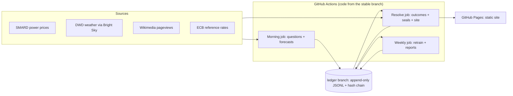

# Forecast Arena

A live, public benchmark in which different kinds of forecasters (simple baselines, a
classical ML model, LLMs with and without data, an LLM agent with tools) predict
tomorrow's real-world outcomes and are scored against what actually happens.

**Research question:** when does an LLM agent beat a classical ML model at forecasting,
and when does it not? An honest "it does not" is a valid result.

This is a research project. Nothing here is advice of any kind.

**Status:** the code is complete through the offline pipeline, the models, the LLM
forecasters and the site. The live pipeline (scheduled GitHub Actions, the public ledger
branch and the GitHub Pages site) is not running yet: it waits for the repository owner
to enable GitHub Actions and GitHub Pages (see `HUMAN_TODO.md`). Live site: not yet
deployed. Rehearsal start date: not yet set.

## How it works



1. **Morning (05:30 and 07:00 UTC).** About 25 yes/no questions about tomorrow are
   generated from live public data: German day-ahead electricity prices, the weather at
   four DWD stations, attention to Wikipedia articles, and the next ECB exchange-rate
   fixing. Every forecaster publishes a probability. The batch is written to the ledger
   and sealed **before the 09:30 UTC lock**.
2. **Resolve (four times a day).** When the answers are published, questions are
   resolved with evidence, finished days are sealed into a hash chain, and the site is
   rebuilt.
3. **Scoring.** Brier and log scores, skill against the base rate, calibration, and
   day-block bootstrap intervals. Below 30 official days everything says "too early to
   tell"; a difference is only called supported when its interval excludes zero.

| Forecaster | What it sees |
|---|---|
| `base_rate`, `persistence` | past outcomes of the same question template |
| `ml` | the as-of data; one model per domain (`docs/models/`) |
| `llm_plain` / `llm_context` | the question (and, for context, the as-of data) |
| `agent` | as `llm_context`, plus read-only tools, at most 4 calls |
| `ensemble`, `human_panel` | later phases |

Integrity rules: forecasts are written before the answer exists and never backdated; the
ledger is append-only and hash-chained; forecasters only see data available at forecast
time; backtests never mix with live scores; failures are recorded as skips, never filled
with a guess. Details: [Methods](docs/METHODS.md).

## Reproduce it

Requirements: Python 3.12 or newer, `git`, `make`. `uv` is optional (faster installs).

```bash
git clone https://github.com/JASHD12/forecast-arena.git
```

```bash
cd forecast-arena
```

```bash
make setup
```

```bash
make check
```

`make setup` creates `.venv` with the pinned dependencies from `requirements-lock.txt`.
`make check` runs the linter, the unit tests and an offline end-to-end run of five
simulated days through the real job code on recorded data. It needs no network and no
API keys.

Other entry points:

| Command | What it does |
|---|---|
| `make smoke-sources` | fetches the latest data from each live source (network) |
| `make site-e2e` | builds the site from the offline run into `_site_e2e/` |
| `make a11y` | accessibility lint of that site (needs Node.js and `npm ci` in `tools/a11y`) |
| `.venv/bin/arena --help` | the command-line interface (jobs, ledger, site, reports) |
| `.venv/bin/arena report backtest-power --first 2025-11-01 --last 2026-10-31` | power backtest (after `arena data backfill`) |

LLM forecasters only call a real provider inside GitHub Actions, with hard daily caps;
locally and in tests they use a scripted fake.

## Data and attribution

| Data | Source | Licence / terms |
|---|---|---|
| Day-ahead electricity prices | Bundesnetzagentur \| SMARD.de | CC BY 4.0 |
| Weather observations and forecasts | Deutscher Wetterdienst (DWD), via Bright Sky | CC BY 4.0 |
| Wikipedia pageviews, article metadata | Wikimedia Foundation, Wikidata | Wikimedia API terms |
| Exchange rates | European Central Bank (log returns computed by this project) | ECB terms: free use with source cited |
| News headlines (agent tool) | GDELT Project | free use with citation |

Every external fact the code relies on is listed with its source and date in
[docs/SOURCES.md](docs/SOURCES.md).

## Limitations

The full list is in [docs/METHODS.md](docs/METHODS.md#known-limitations). The most
important: git timestamps are evidence, not cryptographic proof; backtests cannot use
historical forecasts that were never archived; and with few official days, almost every
comparison is "too early to tell".

## How it was built

The project was specified by its owner (`docs/SPEC.md`) and built by an AI coding agent
following an operating manual (`AGENTS.md`), task by task (`TASKS.md`), with every design
decision logged in `DECISIONS.md` and the agent's state in `PROGRESS.md`. The explainers in
`docs/explainers/` describe each component and the questions it should be able to answer.

## Documentation

- [Specification](docs/SPEC.md)
- [Methods](docs/METHODS.md)
- [Runbook](docs/RUNBOOK.md)
- [Verified external sources](docs/SOURCES.md)
- [Model cards](docs/models/)
- [Explainers](docs/explainers/README.md)
- [Human panel setup](docs/PANEL_SETUP.md)
- [Design decisions](DECISIONS.md)

## Licence

Code: MIT (see `LICENSE`). Data attributions are listed above and on every page of the site.
