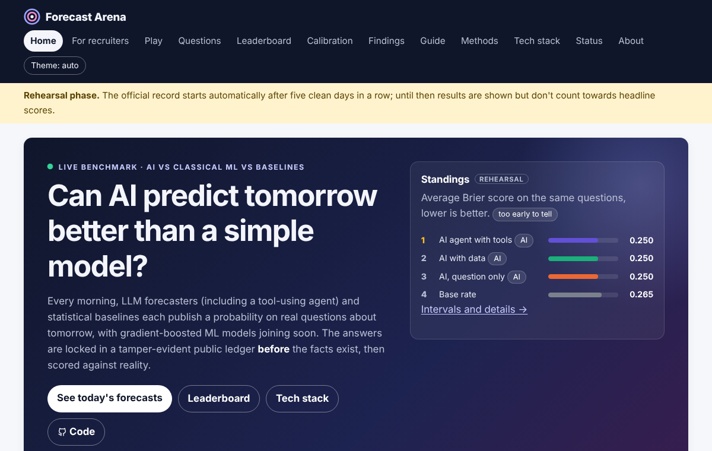
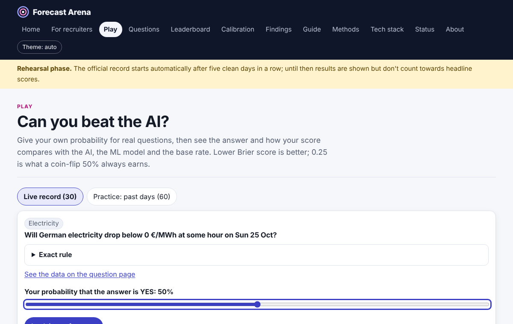
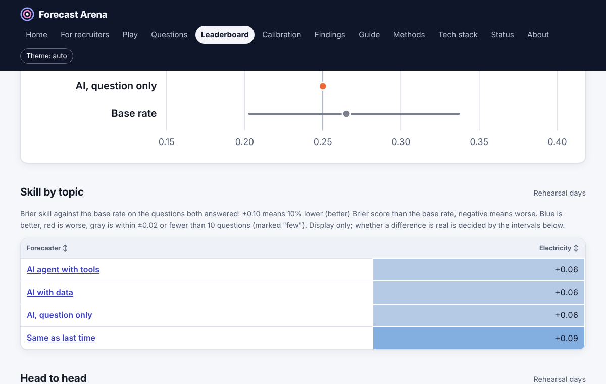
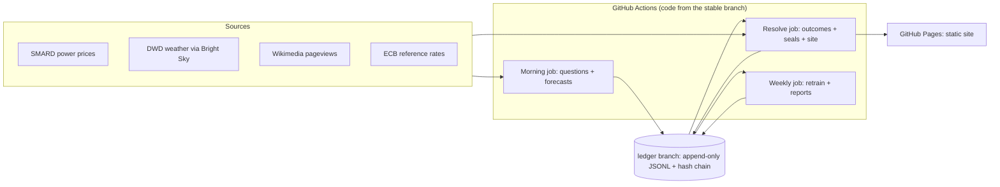

# Forecast Arena

[](https://github.com/JASHD12/forecast-arena/actions/workflows/ci.yml)
[](https://jashd12.github.io/forecast-arena/)
[](LICENSE)

A live, public benchmark in which different kinds of forecasters (simple baselines, a
classical ML model, LLMs with and without data, an LLM agent with tools) predict
tomorrow's real-world outcomes and are scored against what actually happens.

**Research question:** when does an LLM agent beat a classical ML model at forecasting,
and when does it not? An honest "it does not" is a valid result.

This is a research project. Nothing here is advice of any kind.

**Live site: <https://jashd12.github.io/forecast-arena/>**

**Status (2026-11-12):** the live pipeline is running on GitHub Actions. The site and the
public ledger branch went live on 2026-11-12; the first batch of questions and forecasts
was written on 2026-11-13 (rehearsal start date: 2026-11-13). The first days are a *rehearsal*: they are
shown, but excluded from headline scores. The official record starts automatically after
five consecutive clean days (SPEC 2.9). Electricity prices are live first; weather,
Wikipedia attention and exchange rates follow once each has passed its next-day checks.

## At a glance

| Home | Play | Leaderboard |
|---|---|---|
|  |  |  |

*Screenshots of the offline demo build (fixture data, not the live record).*

## Results so far

<!-- results:start -->
All numbers below are **backtests**: past days replayed through the production code, not the live record. Lower Brier is better; always saying 50% scores 0.25. Generated from the model cards in `docs/models/`.

**Electricity: champion vs baselines** (2025-11-01 to 2026-10-31, 365 days)

| Forecaster | n | Brier | 95% interval | Log score |
|---|---|---|---|---|
| base_rate | 2190 | 0.2466 | [0.2424, 0.2510] | 0.6860 |
| persistence | 2190 | 0.2205 | [0.2107, 0.2302] | 0.6327 |
| ml | 2190 | 0.1930 | [0.1818, 0.2043] | 0.5683 |

**Electricity: LightGBM challenger** (2025-11-01 to 2026-10-31, 365 days)

| Forecaster | n | Brier | 95% interval | Log score |
|---|---|---|---|---|
| base_rate | 2190 | 0.2466 | [0.2424, 0.2510] | 0.6860 |
| persistence | 2190 | 0.2205 | [0.2107, 0.2302] | 0.6327 |
| ml | 2190 | 0.1930 | [0.1818, 0.2043] | 0.5683 |
| ml_lgbm | 2190 | 0.1884 | [0.1773, 0.1997] | 0.5584 |

**Electricity: time-series benchmarks** (2025-11-01 to 2026-10-31, 365 days)

| Forecaster | n | Brier | 95% interval | Log score |
|---|---|---|---|---|
| base_rate | 2190 | 0.2466 | [0.2424, 0.2510] | 0.6860 |
| persistence | 2190 | 0.2205 | [0.2107, 0.2302] | 0.6327 |
| ml | 2190 | 0.1930 | [0.1818, 0.2043] | 0.5683 |
| ts_ets | 2190 | 0.2441 | [0.2263, 0.2616] | 0.7466 |
| ts_sarimax | 2190 | 0.2279 | [0.2181, 0.2377] | 0.6607 |
| ts_chronos | 2190 | 0.2142 | [0.2040, 0.2243] | 0.6227 |
<!-- results:end -->

## Skills shown, and where the code is

<!-- skills:start -->
| Skill | In this project | Code |
|---|---|---|
| Python, typing, testing | Typed package, mypy, hundreds of unit tests, property-based tests, offline end-to-end run on every push | `src/arena`<br>`tests`<br>`Makefile` |
| SQL, DuckDB, Parquet | Open data as Parquet; analytics SQL with DuckDB, shown with its queries | `src/arena/analytics/sql.py` |
| dbt | Staging and mart models with tests (unique, not null, accepted values, foreign keys), built in CI | `analytics/dbt` |
| scikit-learn, calibration | Gradient-boosted quantile regression turned into calibrated probabilities | `src/arena/forecasters/ml_power.py` |
| LightGBM, Optuna, SHAP | Challenger tuned with time-ordered cross-validation; SHAP explanations | `src/arena/forecasters/ml_power_lgbm.py`<br>`src/arena/ops/explain.py` |
| PyTorch | Quantile neural network trained with pinball loss; measured against the champion | `src/arena/forecasters/ml_power_torch.py` |
| Time-series models | ETS, SARIMAX (statsmodels) and a pretrained Chronos-Bolt model as benchmarks | `src/arena/forecasters/ts_bench.py` |
| MLOps: MLflow, Evidently, champion/challenger | Weekly retraining with a written promotion rule, run tracking and drift reports | `src/arena/ops/weekly.py`<br>`src/arena/ops/drift.py` |
| Statistics | Proper scoring rules, day-block bootstrap, Diebold-Mariano test, power analysis, conformal prediction | `src/arena/scoring`<br>`src/arena/ops/explain.py` |
| LLM APIs, prompts, structured output | Versioned prompts, strict JSON answers with one repair, hard daily cost caps | `src/arena/forecasters/llm.py`<br>`src/arena/llm` |
| Agents and tool use | Tool-calling agent with call and time limits and prompt-injection-safe tool output | `src/arena/agent/forecaster.py`<br>`src/arena/agent/tools.py` |
| RAG, embeddings | Local ONNX embeddings, similarity search over past questions with a no-leakage rule | `src/arena/agent/retrieval.py` |
| LangGraph | The agent as a state machine (plan, retrieve, tools, critique) behind the same caps | `src/arena/agent/graph.py` |
| Open-weight models (llama.cpp) | A 1.5B model on the CI runner's CPU, same contract as the API model, no API cost | `src/arena/llm/local.py` |
| LLM evals and tracing | Frozen golden set, prompt A/B, JSON validity and cost; one span per model call | `src/arena/evals`<br>`src/arena/llm/tracing.py` |
| MCP | Read-only MCP server so AI assistants can query the benchmark | `src/arena/mcp_server.py` |
| REST and JSON APIs | FastAPI service and a static JSON API with schemas generated from pydantic models | `src/arena/api/app.py`<br>`src/arena/site/api.py` |
| Docker, Kubernetes, Airflow | Image built and API smoke-tested in CI; manifests applied to a kind cluster; DAGs parsed by Airflow (validated in CI, not hosted) | `Dockerfile`<br>`deploy/k8s`<br>`orchestration/airflow` |
| CI/CD on GitHub Actions | Scheduled jobs, promotion to a stable branch after green CI, incident issues | `.github/workflows` |
| Data integrity | Append-only ledger with a daily hash chain; anyone can verify it | `src/arena/ledger` |
| Dashboards and frontend | Streamlit dashboard; static site with an accessible game, checked in Chromium | `apps/dashboard`<br>`src/arena/site`<br>`tools/a11y` |
<!-- skills:end -->

## Using it

You do not need to install anything to follow the benchmark.

| I want to... | Go to |
|---|---|
| See today's questions and every forecaster's probability | [Home](https://jashd12.github.io/forecast-arena/) and [Questions](https://jashd12.github.io/forecast-arena/questions/index.html) |
| See who is winning | [Leaderboard](https://jashd12.github.io/forecast-arena/leaderboard.html) (says "too early to tell" until there is enough data) |
| See whether a forecaster's 70% really means 70% | [Calibration](https://jashd12.github.io/forecast-arena/calibration.html) |
| Read the answer to the research question | [Findings](https://jashd12.github.io/forecast-arena/findings.html) |
| Check that the system ran today | [Status](https://jashd12.github.io/forecast-arena/status.html) |
| Understand the scoring in plain language | [Guide & FAQ](https://jashd12.github.io/forecast-arena/guide.html) |
| Read the full methods | [Methods](https://jashd12.github.io/forecast-arena/methods.html) |
| Get each day's questions in a feed reader | [Atom feed](https://jashd12.github.io/forecast-arena/feed.xml) |

How to read a question: each one is a yes/no statement about tomorrow with an exact
resolution rule (source, threshold, time zone). Every forecaster gives the probability of
YES before 09:30 UTC. When the official data is published, the question resolves and
each forecast gets a Brier score (0 is perfect, 0.25 is what always saying 50% earns,
lower is better).

**Check the record yourself.** Every question, forecast and outcome is an append-only
file on the [`ledger` branch](https://github.com/JASHD12/forecast-arena/tree/ledger),
sealed by a hash chain. After `make setup` (see "Reproduce it"), anyone can verify that
nothing was changed after the fact:

```bash
git clone --branch ledger --single-branch https://github.com/JASHD12/forecast-arena.git _ledger
```

```bash
.venv/bin/arena --ledger-dir _ledger ledger verify --git
```

**Forecast yourself.** A human panel that forecasts the same questions is planned; it
opens once the panel is set up (`docs/PANEL_SETUP.md`).

## How it works



1. **Morning (05:30 and 07:00 UTC).** About 25 yes/no questions about tomorrow are
   generated from live public data: German day-ahead electricity prices, the weather at
   four DWD stations, attention to Wikipedia articles, and the next ECB exchange-rate
   fixing. Every forecaster publishes a probability. The batch is written to the ledger
   and sealed **before the 09:30 UTC lock**.
2. **Resolve (four times a day).** When the answers are published, questions are
   resolved with evidence, finished days are sealed into a hash chain, and the site is
   rebuilt.
3. **Scoring.** Brier and log scores, skill against the base rate, calibration, and
   day-block bootstrap intervals. Below 30 official days everything says "too early to
   tell"; a difference is only called supported when its interval excludes zero.

| Forecaster | What it sees |
|---|---|
| `base_rate`, `persistence` | past outcomes of the same question template |
| `ml` | the as-of data; one model per domain (`docs/models/`) |
| `llm_plain` / `llm_context` | the question (and, for context, the as-of data) |
| `agent` | as `llm_context`, plus read-only tools, at most 4 calls |
| `ensemble`, `human_panel` | later phases |

Integrity rules: forecasts are written before the answer exists and never backdated; the
ledger is append-only and hash-chained; forecasters only see data available at forecast
time; backtests never mix with live scores; failures are recorded as skips, never filled
with a guess. Details: [Methods](docs/METHODS.md).

## Reproduce it

Requirements: Python 3.12 or newer, `git`, `make`. `uv` is optional (faster installs).

```bash
git clone https://github.com/JASHD12/forecast-arena.git
```

```bash
cd forecast-arena
```

```bash
make setup
```

```bash
make check
```

`make setup` creates `.venv` with the pinned dependencies from `requirements-lock.txt`.
`make check` runs the linter, the unit tests and an offline end-to-end run of five
simulated days through the real job code on recorded data. It needs no network and no
API keys.

Other entry points:

| Command | What it does |
|---|---|
| `make smoke-sources` | fetches the latest data from each live source (network) |
| `make site-e2e` | builds the site from the offline run into `_site_e2e/` |
| `make a11y` | accessibility lint of that site (needs Node.js and `npm ci` in `tools/a11y`) |
| `.venv/bin/arena --help` | the command-line interface (jobs, ledger, site, reports) |
| `.venv/bin/arena report backtest-power --first 2025-11-01 --last 2026-10-31` | power backtest (after `arena data backfill`) |

### Quickstart with Docker

```bash
docker compose up --build
```

Then open <http://localhost:8000/docs> for the read-only REST API (it serves the offline
end-to-end ledger; the comment in `compose.yaml` shows how to serve the real record).

LLM forecasters only call a real provider inside GitHub Actions, with hard daily caps;
locally and in tests they use a scripted fake.

### Ask the benchmark from Claude (MCP)

`arena mcp` serves a local copy of the ledger to any MCP host over stdio, read-only, with
four tools: `list_questions`, `get_question`, `leaderboard` and `run_sql` (one SELECT
over the DuckDB tables of the Open data page; file and network access are switched off).

```bash
git clone --branch ledger --single-branch https://github.com/JASHD12/forecast-arena.git _ledger
```

```bash
.venv/bin/pip install -r requirements-mcp.txt
```

```bash
claude mcp add forecast-arena -- "$PWD/.venv/bin/arena" --ledger-dir "$PWD/_ledger" mcp
```

For Claude Desktop, add the same command and arguments as a server entry in its
`claude_desktop_config.json`. Then ask, for example, "Which forecaster has the best Brier
score on electricity questions?"

## Auf Deutsch

Forecast Arena ist ein öffentlicher Forschungs-Benchmark. Jeden Morgen entstehen aus
öffentlichen Daten Ja/Nein-Fragen über den nächsten Tag (zunächst deutsche
Day-Ahead-Strompreise). Basisrate, ein Gradient-Boosting-Modell, Sprachmodelle und zwei
KI-Agenten geben ihre Wahrscheinlichkeit ab, **bevor** die Antwort feststeht; alles wird in
ein öffentliches, nur erweiterbares und per Hash verkettetes Protokoll geschrieben und am
nächsten Tag mit dem Brier-Score bewertet. Forschungsfrage: Wann schlägt ein KI-Agent ein
klassisches Modell, und wann nicht? Eine Kurzfassung steht auf der Seite
[Auf Deutsch](https://jashd12.github.io/forecast-arena/de.html). Forschungsprojekt, keine
Beratung. (Die deutsche Fassung wartet noch auf eine muttersprachliche Durchsicht.)

## Data and attribution

| Data | Source | Licence / terms |
|---|---|---|
| Day-ahead electricity prices | Bundesnetzagentur \| SMARD.de | CC BY 4.0 |
| Weather observations and forecasts | Deutscher Wetterdienst (DWD), via Bright Sky | CC BY 4.0 |
| Wikipedia pageviews, article metadata | Wikimedia Foundation, Wikidata | Wikimedia API terms |
| Exchange rates | European Central Bank (log returns computed by this project) | ECB terms: free use with source cited |
| News headlines (agent tool) | GDELT Project | free use with citation |
| Crypto prices (built, not live yet) | [Data provided by CoinGecko](https://www.coingecko.com) | CoinGecko API terms, attribution required |

Every external fact the code relies on is listed with its source and date in
[docs/SOURCES.md](docs/SOURCES.md).

## Limitations

The full list is in [docs/METHODS.md](docs/METHODS.md#known-limitations). The most
important: git timestamps are evidence, not cryptographic proof; backtests cannot use
historical forecasts that were never archived; and with few official days, almost every
comparison is "too early to tell".

## How it was built

The project was specified by its owner (`docs/SPEC.md`) and built by an AI coding agent
following an operating manual (`AGENTS.md`), task by task (`TASKS.md`), with every design
decision logged in `DECISIONS.md` and the agent's state in `PROGRESS.md`. The explainers in
`docs/explainers/` describe each component and the questions it should be able to answer.

## Documentation

- [Specification](docs/SPEC.md)
- [Methods](docs/METHODS.md)
- [Runbook](docs/RUNBOOK.md)
- [EU and German rules checklist](docs/COMPLIANCE.md)
- [Verified external sources](docs/SOURCES.md)
- [Model cards](docs/models/)
- [Explainers](docs/explainers/README.md)
- [Human panel setup](docs/PANEL_SETUP.md)
- [Demo script](docs/DEMO.md)
- [Design decisions](DECISIONS.md)

## Licence

Code: MIT (see `LICENSE`). Data attributions are listed above and on every page of the site.
