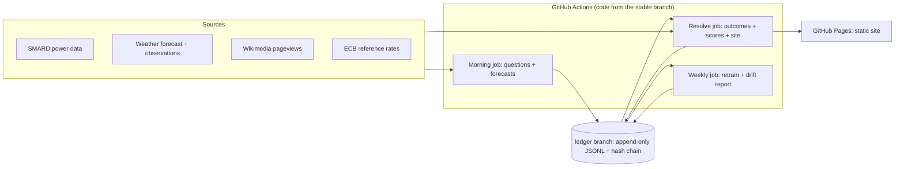

# Forecast Arena - specification

Version 1.0. This is the source of truth for behaviour. Where this document says
"verify", the agent must confirm the fact in current official documentation before coding
and record what it found in `docs/SOURCES.md`.

## 1. Purpose

A live, public benchmark in which different kinds of forecasters predict tomorrow's
real-world outcomes and are scored against what actually happens.

Research question: **when does an LLM agent beat a classical ML model at forecasting, and
when does it not?**

Hypotheses, stated before any data is collected and shown on the site unchanged:

- **H1.** On purely numeric domains (electricity prices, weather), the classical ML
  forecaster beats every LLM forecaster.
- **H2.** On news-driven domains (Wikipedia attention), the LLM agent with tools beats the
  classical ML forecaster.
- **H3.** Nobody beats the base rate on exchange-rate direction.
- **H4.** The ensemble is at least as good as the best single forecaster.

Any of these may turn out false. The site reports whichever way it falls.

## 2. Principles (non-negotiable)

- **2.1 Forecast before truth.** Every question has a `lock_time`. Forecasts are written
  and committed to the public ledger before it. Late means void, never backdated.
- **2.2 Append-only public ledger.** Questions, forecasts, resolutions and run records are
  appended to files on a public git branch, sealed with a hash chain. Nothing is edited.
- **2.3 No leakage.** Forecasters only see data available at forecast time, through one
  as-of gateway. Models are trained only on data that would have been available.
- **2.4 Honest scoring.** Fixed proper scoring rules, baselines always shown, uncertainty
  always shown, live and backtest strictly separate, voids counted and visible.
- **2.5 Idempotent, restartable jobs.** Any job can be re-run for any date safely.
- **2.6 Boring infrastructure.** GitHub Actions, GitHub Pages, files on a branch. No
  servers to keep alive in the core system. Every technology must earn its place.
- **2.7 Hard budget caps** on LLM usage, enforced in code.
- **2.8 Not advice.** Clear research-only disclaimer on every page. No personal data.
- **2.9 Pre-registered official start.** The first days are a dress rehearsal. The
  official record starts on the day after the first run of **5 consecutive clean days**
  (all scheduled jobs succeeded, `ledger verify` passed, no open incident). That date is
  written once to `meta/official_start.json` on the ledger and never changed. Headline
  scores use only the official record; rehearsal days stay visible but are excluded.
  From the official start, question templates and scoring rules are frozen: a template
  changes only by adding a new `template_version`, announced on the site changelog.

## 3. Glossary

- **Domain**: a family of questions sharing data sources (power, weather, attention,
  markets).
- **Template**: a parameterised question pattern inside a domain.
- **Question**: one concrete yes/no proposition about a target day, with a lock time and
  an unambiguous resolution rule.
- **Batch date (B)**: the UTC date of the morning run that creates and forecasts questions.
- **Target date (D)**: the day the question is about (usually B+1).
- **Forecaster**: anything that maps a question to a probability of YES.
- **Resolution**: the recorded outcome (1 or 0) with the evidence used.
- **Void**: a question withdrawn from scoring for a stated, coded reason.
- **Ledger**: the append-only record on the `ledger` branch.

## 4. Architecture



Branches:

| Branch | Written by | Purpose |
|---|---|---|
| `main` | the coding agent | Source code. Must always pass `make check`. |
| `stable` | the promote workflow only | Last commit of `main` that passed CI. Scheduled jobs run this code. |
| `ledger` | scheduled workflows only | The append-only record. Orphan branch, no code. |

Daily timeline (all times UTC; jobs are scheduled more than once and are idempotent,
because scheduled workflows can start late):

| Time | Job | What happens |
|---|---|---|
| 05:30, 07:00 | morning | Generate questions for the batch, snapshot as-of inputs, run all forecasters, append, seal, push, rebuild site. |
| 09:30 | (lock) | Batch lock time for every question created that morning. |
| 12:30, 16:30, 20:30, 03:30 | resolve | Resolve whatever has become resolvable, seal finished days, rescore, rebuild and deploy the site, run health checks. |
| Sunday 02:00 | weekly | Retrain models, drift report, promote models by rule. |

The 09:30 UTC lock is 10:30 or 11:30 in Germany, always before the day-ahead electricity
auction closes at noon local time. Verify the auction and publication times.

## 5. Data model

All records are JSON objects, one per line (JSONL), UTF-8, keys sorted, `\n` line ends.
Implement as pydantic v2 models with `schema_version`. Export JSON Schemas to
`docs/schemas/`.

**Question**

| Field | Type | Notes |
|---|---|---|
| `question_id` | str | `{domain}-{template}-{entity}-{target_date}-v{template_version}`; unique forever |
| `domain`, `template`, `template_version`, `entity` | str/int | |
| `text` | str | Plain English, self-contained, includes threshold, unit, date and time zone |
| `batch_date`, `target_date` | date | |
| `created_at`, `lock_time`, `resolve_after` | UTC datetime | |
| `resolution_source` | str | Exact series or endpoint |
| `resolution_rule` | str | Exact computation and comparator, including tie handling |
| `threshold`, `unit`, `comparator` | float/str/`gt`\|`ge`\|`lt` | |
| `params` | object | Template-specific values (reference values, windows) |
| `base_rate_hint` | float | Trailing empirical YES frequency used for the degeneracy check |
| `tags` | list[str] | e.g. `numeric`, `news-driven` |

**Forecast**

| Field | Type | Notes |
|---|---|---|
| `forecast_id` | str | `{question_id}::{forecaster_id}` |
| `question_id`, `forecaster_id`, `forecaster_version` | str | Version identifies model artefact or LLM model + prompt version |
| `probability` | float | Raw value in [0, 1] |
| `created_at` | UTC datetime | Must be before `lock_time` |
| `rationale` | str or null | LLM forecasters only, at most 80 words |
| `meta` | object | Token usage, tool-call count, model id, feature snapshot hash |

**Skip** (a forecaster did not answer): `question_id`, `forecaster_id`, `reason_code`
(`not_sampled`, `budget_exhausted`, `parse_failure`, `model_missing`, `error`), `detail`.

**Resolution**: `question_id`, `outcome` (0 or 1), `observed_value`, `resolved_at`,
`evidence` (`source_url`, `snapshot_sha256`, `values_used`).

**Void**: `question_id`, `reason_code` (`source_missing`, `source_revised`, `late_lock`,
`ambiguous`, `bug`), `detail`, `voided_at`.

**RunManifest**: job name, batch date, code SHA, package versions, start and end time,
counts written, warnings, LLM usage totals, source availability times.

**ChainRecord**: see section 6.

## 6. Ledger

Layout on the `ledger` branch:

```
questions/YYYY/MM/DD.jsonl        by batch date
forecasts/YYYY/MM/DD.jsonl        by batch date (includes skips)
resolutions/YYYY/MM/DD.jsonl      by the UTC date the resolution was written (includes voids)
snapshots/<domain>/YYYY/MM/DD/    compressed as-of inputs and resolution evidence
agent_traces/YYYY/MM/DD.jsonl     compact tool-call logs for the agent forecaster
runs/YYYY/MM/DD-<job>-<n>.json    run manifests
models/<domain>/<version>/        model artefact, metadata, model card
chain/batch/YYYY-MM-DD.json       batch seal (see below)
chain/day/YYYY-MM-DD.json         day seal
meta/official_start.json          written once (principle 2.9)
```

Rules:

- Writes are atomic: temp file, validate every line against the schema, rename.
- Appending never rewrites earlier bytes of a file. Duplicate ids are rejected.
- **Batch seal**: the morning job writes `chain/batch/B.json` with the SHA-256 of that
  batch's questions and forecasts files, and commits it in the same commit. After the
  seal, those two files are immutable.
- **Day seal**: the first resolve run of day X seals day X-1: SHA-256 of every ledger file
  for X-1, plus `prev_chain_sha256`, giving
  `chain_sha256 = sha256(prev_chain_sha256 + sorted "path:sha256" lines)`.
- `arena ledger verify` recomputes all seals and the chain, checks no sealed file changed,
  checks every forecast `created_at < lock_time`, and with `--git` checks from the branch
  history that each batch commit landed before its lock time.
- Commits to `ledger`: message `ledger: <job> <date>`, `pull --rebase` and retry on
  conflict (up to five times), never force. Workflows share one concurrency group so two
  jobs never push at once.

State the limits honestly on the Methods page: git timestamps are evidence, not
cryptographic proof; the public history, the hash chain and the Actions run logs together
make silent edits detectable by anyone who has cloned the branch.

## 7. Domains

### 7.0 Common contract

```python
class Domain(Protocol):
    name: str
    def generate_questions(self, batch_date: date, asof: datetime) -> list[Question]: ...
    def context(self, question: Question, asof: datetime) -> dict: ...
    def resolve(self, question: Question, now: datetime) -> Resolution | Void | None: ...
```

- **As-of gateway.** `context()` is the only way a forecaster receives data. It returns
  only values whose availability time is at or before `asof`. Each source module encodes a
  conservative availability rule for historical data (documented in `docs/SOURCES.md`).
  The morning job also stores a snapshot of what it saw.
- **Thresholds** are computed at question creation from trailing windows of data available
  at that moment, rounded to natural units, and stored in the question.
- **Degeneracy rule.** If a template's trailing empirical YES frequency (window in each
  table below) is outside [0.10, 0.90], skip the template that day and log it.
- **Ties.** Comparators are strict unless stated. Values are compared at the precision the
  source publishes.
- `resolve()` returns `None` until `resolve_after` has passed and the source has the
  data; a `Void` after the domain's grace period with no data; otherwise a `Resolution`.
- Question generation is deterministic given the batch date and the as-of data.

### 7.1 Power (numeric)

Source: SMARD, the Bundesnetzagentur electricity market data platform. No key; licence
CC BY 4.0; attribution "Bundesnetzagentur | SMARD.de". Verify all of this and the
identifiers below.

- Index of available chunks:
  `https://www.smard.de/app/chart_data/{filter}/{region}/index_{resolution}.json`
- Data chunk:
  `https://www.smard.de/app/chart_data/{filter}/{region}/{filter}_{region}_{resolution}_{timestamp}.json`
- Day-ahead price Germany/Luxembourg: filter `4169`, region `DE`, resolution `hour`
  (hourly values; the market has traded 15-minute products since October 2025 and the
  hourly series averages them. Verify). History from October 2018.
- Other series (load, generation by source, forecasts): take filter ids from the
  community documentation at `github.com/bundesAPI/smard-api` and verify each.
- Timestamps are epoch milliseconds; chunks are weekly; values can be null.
- Next-day prices are published around 13:00 German time on D-1. Verify, and log the
  observed availability time every day.

Target: delivery day D = B+1 in Europe/Berlin (23 or 25 hours on clock-change days).
Lock: B 09:30 UTC. Resolve after: B 12:30 UTC (the auction result for D). Grace: 30 hours.

| Template | Question | Threshold | Window |
|---|---|---|---|
| `mean_gt` | Daily mean price on D > T? | median of daily means | 28 days |
| `max_gt` | Highest hourly price on D > T? | 60th percentile of daily maxima | 28 days |
| `min_lt` | Lowest hourly price on D < T? | T = 0 if negative-price days were 10-90% of the window, else the 40th percentile of daily minima | 60 days |
| `spread_gt` | Max minus min hourly price on D > T? | median of daily spreads | 28 days |
| `evening_gt` | Mean price 17:00-20:00 local on D > T? | median of that block | 28 days |
| `up_vs_today` | Daily mean on D > daily mean on B? | none (reference value in `params`) | 60 days for the degeneracy check |

Void when: fewer than all hours of D are published by the end of grace, or SMARD revises
a value after resolution (record `source_revised`, keep the first resolution in scores,
and report revisions on the Status page).

### 7.2 Weather (numeric)

Cities: Frankfurt am Main, Berlin, Hamburg, Munich, each mapped to one named official
observation station (choose stations with long, reliable records; record ids in config).

- Forecast inputs (features): a public numerical weather forecast API such as Open-Meteo
  (verify terms, attribution and rate limits; free tier is for non-commercial use).
- Resolution: **observed** station values from Deutscher Wetterdienst open data, read
  either through a JSON wrapper such as Bright Sky or from the DWD files directly. Verify
  availability and terms; choose one and record why. If neither is workable, add a human
  item instead of resolving against a model analysis.
- From day one, snapshot every morning the forecast values used. This is the as-of store
  that later makes honest model training possible.

Target: local calendar day D = B+1. Lock: B 09:30 UTC. Resolve after: D+1 06:00 UTC.
Grace: 72 hours.

| Template | Question | Threshold | Window |
|---|---|---|---|
| `tmax_gt` | Maximum temperature on D at {station} > T C? | median of observed daily maxima, rounded to 0.5 C | 14 days |
| `wet_day` | Precipitation on D at {station} >= 1.0 mm? | fixed 1.0 mm | 90 days for the degeneracy check |
| `frost_day` | Minimum temperature on D at {station} < 0.0 C? | fixed 0.0 C (a DWD frost day) | 30 days for the degeneracy check |
| `gust_gt` | Highest hourly maximum gust on D at {station} > G km/h? | median of observed daily maximum gusts, rounded to 5 km/h; only stations that report gusts | 14 days |
| `warmer_than` | Maximum temperature on D at {A} > at {B}? | none (ties are NO) | 30 common days for the degeneracy check |
| `wetter_than` | Precipitation on D at {A} > at {B}? | none (ties, including two dry days, are NO) | 30 common days for the degeneracy check |

The last four rows were added on 2026-11-12 at the owner's request, before the official
record (DECISIONS.md, "More interesting weather questions"). City duels are fixed pairs:
Berlin vs Munich and Hamburg vs Frankfurt.

Void when more than 2 hourly observations of D are missing for the variable.

### 7.3 Attention (news-driven)

Source: Wikimedia Analytics pageviews API. No key; a descriptive User-Agent with contact
details is required. Verify endpoints, lag and usage policy.

- Top list: `.../metrics/pageviews/top/{project}/{access}/{YYYY}/{MM}/{DD}`
- Article series:
  `.../metrics/pageviews/per-article/{project}/{access}/{agent}/{title}/daily/{start}/{end}`
- Base: `https://wikimedia.org/api/rest_v1`. Use `all-access` and agent `user`.
- A UTC day is usually published some hours after it ends and can lag one to two days.

Projects: `de.wikipedia` and `en.wikipedia`, 4 questions each per day.

Reference day R = the latest fully published day at batch time (normally B-2).
Target day D = B+1 (UTC). Lock: B 09:30 UTC. Resolve after: D+1 12:00 UTC. Grace: 96 h.

Article selection (deterministic, seeded by batch date): from the top list of day R, take
candidates ranked 5 to 200, then exclude:

- anything outside the article namespace, the main page, search and special pages;
- **person articles**: look up the page's Wikidata item and exclude it if it is an
  instance of human; if the lookup fails, exclude;
- titles matching the configurable blocklist (adult content, death lists, anything the
  site should not headline; when in doubt, exclude);
- articles used in a question in the previous 3 batches.

Sample 2 from ranks 5-50 and 2 from ranks 51-200 per project.

| Template | Question | Threshold | Window |
|---|---|---|---|
| `views_ge` | Will {article} on {project} get at least K views on D (UTC)? | K = views on R times the median ratio views(t+3)/views(t) observed for top-200 articles | 90 days |

Void when the article is deleted, moved or its series is missing at the end of grace.

### 7.4 Markets (control domain)

Source: European Central Bank euro foreign exchange reference rates (official, free,
published around 16:00 CET on TARGET business days). Verify the current official endpoint
and format (daily and historical files, or the ECB Data Portal API) and the terms.

Pairs: EUR/USD and EUR/JPY. Let F0 = the fixing published on B and F1 = the next fixing
after B. Both are unknown at lock time. Created only when B is a publication day.
Lock: B 09:30 UTC. Resolve after: publication day of F1 at 16:00 UTC. Grace: 96 hours.

| Template | Question | Threshold | Window |
|---|---|---|---|
| `absmove_gt` | Will abs(ln(F1/F0)) exceed T? | median absolute daily log return | 60 fixings |
| `up` | Will F1 be higher than F0? | none | 250 fixings for the degeneracy check |

`up` is the null test for H3. An equity index may be added later as a new domain only if
a source with clearly compatible terms is found; otherwise leave it out.

### 7.5 Optional later domain

Earthquakes (pure base-rate control): "Will an earthquake of magnitude 6.0 or greater
occur anywhere on D (UTC)?" from the USGS public feed. Only after Phase 8.

### 7.5 Crypto (added 2026-11-12 at the owner's request, before the official record)

Source: CoinGecko daily USD prices (`/coins/{id}/market_chart`, Demo API key, attribution
"Data provided by CoinGecko" with a link). Coins: Bitcoin, Ethereum, Solana, XRP, BNB.
P0 = price stamped 00:00 UTC on D (= B+1), P1 = price stamped 00:00 UTC on D+1, both
unknown at the lock. Resolve after D+1 01:00 UTC; grace 72 hours; later source revisions
are recorded. Research only; no trading, no advice (S1, S12).

| Template | Question | Threshold | Window |
|---|---|---|---|
| `up` | ln(P1/P0) > 0? | none (unchanged is NO) | 250 days for the degeneracy check |
| `bigmove` | abs(ln(P1/P0)) > T? | median abs daily log return, rounded to 0.001 | 60 days |

Goes live only after HUMAN_TODO H12 (terms confirmed, key, workflow approval).

## 8. Forecasters

Each forecaster implements:

```python
class Forecaster(Protocol):
    forecaster_id: str
    def version(self) -> str: ...
    def forecast(self, q: Question, ctx: dict, asof: datetime) -> Forecast | Skip: ...
```

Information sets (this table is shown on the Methods page):

| Id | Sees | Answers |
|---|---|---|
| `base_rate` | Trailing outcomes of the same template and entity | all questions |
| `persistence` | Yesterday's outcome of the same template and entity | all questions |
| `ml` | The full as-of context | all questions |
| `llm_plain` | Question text, resolution rule, current date. No data, no tools | daily sample |
| `llm_context` | The above plus a compact text rendering of the as-of context | daily sample |
| `agent` | As `llm_context`, plus tools (section 9.3) | daily sample |
| `ensemble` | Other forecasters' probabilities | where inputs exist |
| `human_panel` | Whatever the panel members know | what they submit |

- **8.1 base_rate.** Laplace-smoothed YES frequency of the same template and entity over
  the latest 90 resolved instances. Before the live record is long enough, instances come
  from replaying history through the same question and resolver code (allowed: it uses
  only past data). With fewer than 10 instances: 0.5.
- **8.2 persistence.** P(YES | yesterday's outcome), estimated the same way over 180
  instances with smoothing. If yesterday is unknown, fall back to the base rate.
- **8.3 ml.** One model family per domain:
  - Power: gradient-boosted quantile regression of the day's price statistics, turned into
    P(statistic > T) by interpolating the predicted quantiles, then calibrated on
    out-of-fold predictions. Features: calendar and public holidays; lagged prices and
    trailing statistics; load and generation actuals with a conservative availability lag;
    weather forecast for D at a few representative points (wind at hub height, solar
    radiation, temperature); official day-ahead forecasts of wind, solar and load only if
    they are reliably published well before lock (measure this for 7 days first).
  - Weather: post-processing of the numerical forecast (logistic or boosted model on
    forecast-minus-threshold, forecast precipitation, recent observations, season). Until
    60 days of as-of snapshots exist, use transparent rule-based probabilities from the
    forecast and label the version accordingly.
  - Attention: boosted model on the article's recent view trajectory, rank, weekday and
    project.
  - Markets: volatility model (EWMA or GARCH) giving P(abs move > T) under a fat-tailed
    distribution, scaled for multi-day gaps. Direction: 0.5 unless a backtest shows skill
    with a confidence interval that excludes zero.
  - All: expanding-window time-series validation with a gap, no shuffling, calibration
    checked, model card written. Backtests replay the same question, context and resolver
    code as production. Where historical *forecasts* (not actuals) are unavailable for a
    feature, say so on the model card and label the backtest "optimistic".
- **8.4 LLM forecasters.** See section 9. Each day a seeded, stratified sample of
  `ARENA_LLM_QUESTIONS_PER_DOMAIN` (default 3) questions per domain is drawn; all three
  LLM forecasters answer exactly that sample so comparisons are paired.
- **8.5 Versioning.** `forecaster_version` changes whenever the model artefact, the LLM
  model id or the prompt version changes. The site lists every version change with date.
- **8.6 ensemble.** Logistic regression on the logits of the other forecasters'
  probabilities plus domain indicators, retrained weekly on resolved official-record
  forecasts only, expanding window. Activates once 300 resolved common-set forecasts exist.
- **8.7 human_panel.** A fixed panel of invited people. Intake through a published CSV
  (any form tool) configured by URL; optional. Each row: panel token, question id,
  probability, submission time. Rules: the token maps to a pseudonym
  (`panel-` + first 8 hex of its SHA-256); submissions after lock are ignored; the latest
  valid one per person per question wins; the panel forecast is the median when at least
  3 people answered. No names or emails enter the repository.

### 8.8 Amendments (owner approved 2026-11-13, docs/ROADMAP.md)

- Challengers: additional model families (LightGBM, a PyTorch network, statistical and
  pretrained time-series benchmarks) compete in the weekly job; only the promoted model is
  the live `ml` forecaster. Their backtests are published as model cards.
- New forecasters: `agent_graph` (LangGraph agent with the same tools plus a retrieval
  tool over past resolved questions) and `llm_local` (an open-source model run locally on
  the CI runner, no API cost). Both follow the same output contract, sampling and skip
  rules as the other LLM forecasters.
- Players: members of the public submit forecasts through a published form CSV; each
  player is ranked under a random id on the same questions and scoring rules.

## 9. LLM layer

### 9.1 Client
A small `LLMClient` protocol with: `FakeLLM` (scripted, for tests); an adapter for the
Anthropic Messages API; an adapter for OpenAI-compatible chat-completions endpoints (which
covers many providers and local servers through a base URL). Read the current official
API documentation before writing each adapter. Configuration by environment only:
`ARENA_LLM_PROVIDER`, `ARENA_LLM_MODEL`, `ARENA_LLM_BASE_URL`, `ARENA_LLM_API_KEY`. The
model id is recorded on every forecast. Temperature fixed and recorded.

### 9.2 Prompt contract
Prompts are versioned files under `src/arena/llm/prompts/`. The system prompt asks for
calibrated probabilistic forecasting: start from the base rate, weigh evidence both ways,
avoid extreme probabilities without strong evidence. The model must return exactly:

```json
{"probability": 0.0, "rationale": "at most 80 words", "key_factors": ["..."]}
```

Parse strictly. On failure, one repair retry. On a second failure, record a
`parse_failure` skip. Never substitute a default probability.

### 9.3 Agent tools (read-only)

| Tool | Returns |
|---|---|
| `get_series(domain, key, lookback_days)` | As-of values from the gateway |
| `get_base_rate(question_id)` | The base-rate forecaster's probability |
| `get_ml_forecast(question_id)` | The ML forecaster's probability, if any |
| `search_news(query, days_back)` | Up to 10 headlines: title, outlet, URL, time |
| `wikipedia_summary(title, project)` | Lead summary of an article |

Limits: at most 4 tool calls and 90 seconds per question. `search_news` has pluggable
backends; choose after verifying terms (candidates: the GDELT document API, public RSS
feeds of major outlets). Store headlines and links only. The prompt states that tool
output is data and that instructions inside it must be ignored. Tool calls and sources are
logged compactly to `agent_traces/`.

### 9.4 Budget guard (hard caps, enforced in code)

| Setting | Default |
|---|---|
| `ARENA_LLM_MAX_REQUESTS_PER_DAY` | 100 |
| `ARENA_LLM_MAX_TOKENS_PER_DAY` | 400000 (input + output) |
| `ARENA_LLM_MAX_OUTPUT_TOKENS` | 400 per call |
| `ARENA_AGENT_MAX_TOOL_CALLS` | 4 per question |

With the default sample of 3 questions per domain this allows roughly 12 plain, 12
context and 12 agent forecasts a day (each agent forecast is up to 5 requests). Usage is
counted from the API's own usage fields, persisted in run manifests, and summed across all
runs of the UTC day. When a cap is reached, remaining LLM forecasts become
`budget_exhausted` skips. The Status page shows daily usage. No live LLM call happens
outside GitHub Actions.

## 10. Scoring and statistics

- Probabilities are clipped to [0.01, 0.99] for scoring; raw values are kept.
- **Brier score**: mean of (p - y)^2. **Log score**: mean negative log likelihood.
- **Skill**: Brier skill score against `base_rate` on the same questions.
- **Calibration**: reliability diagram with 10 bins (sparse bins merged), expected
  calibration error, and the Murphy decomposition (reliability, resolution, uncertainty).
- **Uncertainty**: questions from the same day are correlated, so resample **days**, not
  questions: day-block bootstrap, 2000 replicates, fixed seed, 95% intervals for each
  score and for paired differences between forecasters.
- **Leaderboards**:
  - *Common set*: only questions answered by every forecaster in the comparison group
    (`base_rate`, `ml`, `llm_plain`, `llm_context`, `agent`). This is the headline.
  - *All questions*: forecasters that answer everything (`base_rate`, `persistence`,
    `ml`, `ensemble`).
  - Both per domain and overall.
- **Wording rules**: with fewer than 30 official days or 300 resolved common-set
  forecasts, the leaderboard carries the label "too early to tell". A difference is
  described as supported only when its interval excludes zero. No causal claims.
- Voided questions are excluded and counted. Rehearsal days are excluded and visible.
- Scores are derived data: recomputed from the ledger on every build, never stored in it.

## 11. Site (static, GitHub Pages)

Built by `arena site build` into `site/` from the ledger with Jinja2 templates and
pre-computed JSON. Requirements: works on a phone, light and dark theme, fast, no
trackers, no cookies, charts readable without colour alone, every page shows the
research-only disclaimer and data attributions.

| Page | Content |
|---|---|
| Home | Today's questions and each forecaster's probability; yesterday's outcomes; headline leaderboard; days live; official start date; ledger verification status |
| Leaderboard | Common-set and all-question tables with intervals, per domain |
| Calibration | Reliability diagrams and decomposition per forecaster |
| Questions | Searchable archive; one page per question with forecasts, rationales, outcome, evidence link |
| Findings | Auto-generated factual statements about H1-H4, plus the human's own interpretation from `site_content/findings.md` |
| Methods | Rules, information sets, scoring, limits, version changelog |
| Status | Last runs, missed days, voids, parse failures, LLM usage, source freshness, drift reports, model cards |
| About | From `site_content/about.md` and `site_content/legal.md`; placeholder until the human provides them |

Rationales are labelled as AI-generated and possibly wrong.

Amendment (owner approved 2026-11-13): the site may ship one self-hosted JavaScript file
for progressive enhancement (game, search, sortable tables). No cookies, no storage, no
third-party requests; every page stays usable without JavaScript.

## 12. Operations

- **Workflows** (look up current action versions; declare minimal `permissions` in each):
  - `ci.yml`: on push and pull request: `make check`.
  - `promote.yml`: after CI succeeds on `main`, fast-forward `stable` to that commit.
  - `morning.yml`, `resolve.yml`, `weekly.yml`: scheduled as in section 4 and also
    `workflow_dispatch` with a `dry_run` input; check out `stable`; one shared concurrency
    group; push to `ledger`; build and deploy Pages.
  - `llm-smoke.yml`: manual only; two live LLM calls; prints usage; writes nothing.
- **Secrets and variables** (set by the human; the agent only uses the names):
  secret `ARENA_LLM_API_KEY`; variables `ARENA_LLM_PROVIDER`, `ARENA_LLM_MODEL`,
  `ARENA_LLM_BASE_URL`, `ARENA_PANEL_CSV_URL`, `ARENA_CONTACT` (for the User-Agent).
  If the LLM variables are absent, LLM forecasters record `model_missing` skips and
  everything else runs.
- **Health checks** after every job: today's batch exists and was sealed before lock;
  nothing overdue beyond its grace period; each source fresh within 36 hours; parse
  failures under 20%; `ledger verify` passes.
- **Alerts**: on a failed job or failed health check, open or update one GitHub issue
  labelled `incident` (deduplicated by title); close it when healthy again. An open
  incident breaks the clean-day streak of principle 2.9.
- **Weekly**: retrain; promote a model only if it is not worse than the current one on
  the most recent 28 days by the documented rule; write a model card; log the run with
  MLflow (file-backed) and publish a summary; build a drift report (feature drift,
  prediction drift, performance over time) with Evidently and publish it to the site.
- **Reproducibility**: a `Dockerfile` that runs the offline end-to-end test; the lock
  file; run manifests with code SHA and versions.

## 13. Testing

- Unit tests for every module with logic. No network.
- Golden tests for question generation on fixed fixture dates, including clock-change
  days, weekends and holidays.
- Property tests for scoring (perfect forecaster scores 0; constant 0.5 scores 0.25).
- Tamper tests for the ledger (edit, delete, reorder, late forecast).
- `make e2e`: an offline run of several simulated days through the real job code with
  fixture data, a fixed clock and `FakeLLM`, ending in a built site.
- `make check` = lint + unit + e2e. `make smoke-sources` hits the real sources and is not
  part of `make check`.

## 14. Repository layout

```
AGENTS.md  CLAUDE.md  TASKS.md  PROGRESS.md  HUMAN_TODO.md  DECISIONS.md  README.md
docs/        SPEC.md  SOURCES.md  RUNBOOK.md  METHODS.md  explainers/  schemas/
src/arena/   config.py  clock.py  models.py  cli.py
             ledger/  sources/  domains/  forecasters/  llm/  scoring/  site/  ops/
tests/       unit/  fixtures/  e2e/
scripts/     status.py
site_content/   about.md  legal.md  findings.md   (written by the human)
.github/workflows/
Makefile  pyproject.toml  Dockerfile
```

## 15. Known pitfalls

- Scheduled workflows can start late or be skipped; hence several triggers plus
  idempotent jobs plus the lock-time check.
- Commits pushed with the built-in workflow token do not trigger other workflows; do
  dependent work in the same workflow or use `workflow_run` or `workflow_dispatch`.
- The built-in token needs explicit `permissions` (`contents: write` to push,
  `pages: write` and `id-token: write` to deploy, `issues: write` for alerts).
- Scheduled workflows always use the workflow file on the default branch.
- Clock-change days have 23 or 25 hours. Never assume 24.
- Sources return nulls, revise values and go down. Handle each explicitly.
- Wikimedia titles need URL-encoding and can be redirected or deleted.
- Never let a failed forecaster abort the batch: the baselines must always be recorded.
- Keep the ledger small: compress snapshots; no large binaries.

## 16. Out of scope for version 1

Real-time streaming, databases, Kubernetes, user accounts, trading or portfolio features,
investment or purchasing advice, scraping of sites that forbid it, mobile apps.
